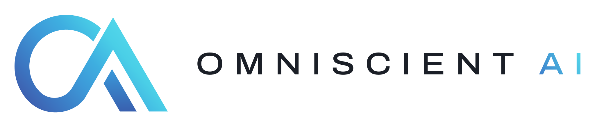

<h1 align="center">TickerNet</h1>

<p align="center">
  <strong>An open-source background job scheduler for .NET</strong><br />
  Source-generated jobs, cron and one-off scheduling, your own database, and a live dashboard.
</p>

<p align="center">
  <a href="https://github.com/TickerNet/TickerNet/actions/workflows/ci.yaml"></a>
  <a href="https://tickernet.github.io/TickerNet/"></a>
  <a href="LICENSE"></a>
</p>

<p align="center">
  <sub>MAINTAINED AND SPONSORED BY</sub><br />
  <a href="https://omniscient.to">
    <picture>
      <source media="(prefers-color-scheme: dark)" srcset="site/assets/sponsor/omniscient-logo-horizontal-dark-bg.svg" />
      
    </picture>
  </a>
</p>

---

TickerNet is a fork of [TickerQ](https://github.com/Arcenox-co/TickerQ), taken from its last open-source commit before
TickerQ moved to a commercial license. [Omniscient AI](https://omniscient.to) set up the fork, maintains it and funds
its development, and makes two promises on the project's behalf:

> [!TIP]
> **Build anything on it.** Use, change and redistribute TickerNet under **MIT or Apache-2.0**, whichever you choose.
> Fork it, build closed-source or commercial products on it, and keep your changes private. Nothing in TickerNet's
> governance adds conditions to that. See [your freedom to build on TickerNet](GOVERNANCE.md#your-freedom-to-build-on-tickernet).

> [!IMPORTANT]
> **Open source, forever.** Every TickerNet release stays **MIT OR Apache-2.0**: no paid edition, no source-available
> version, no license keys and no CLA. Omniscient AI has made this an
> [irrevocable pledge](GOVERNANCE.md#open-source-pledge-tickernet-stays-open-source-forever).

> **Preview.** TickerNet is at `1.0.0-preview.1` and isn't on NuGet yet. Until the first release, reference the
> projects from source. The package names below are the ones the first release will use.

## Features

- **Time and cron scheduling**: one-off jobs at a set time, and recurring jobs from cron expressions.
- **Source-generated**: jobs are registered at compile time, with no runtime reflection, so apps can be trimmed and
  compiled ahead of time.
- **Your own storage**: EF Core (PostgreSQL, SQL Server, SQLite, MySQL), Redis or MongoDB.
- **Live dashboard**: a SignalR dashboard to watch, inspect and manage jobs.
- **Retries and throttling**: retry policies with backoff.
- **Several nodes**: Redis heartbeats, dead-node cleanup and lock-based coordination.
- **Remote workers**: run job code in separate worker processes that connect to your scheduler. The scheduler is the
  hub, so there's no hosted service to sign up for.
- **OpenTelemetry**: tracing for job runs.

## Quick start

### 1. Register services

```csharp
var builder = WebApplication.CreateBuilder(args);

builder.Services.AddTickerNet();

var app = builder.Build();
app.UseTickerNet();
app.Run();
```

### 2. Write a job

```csharp
using TickerNet.Utilities.Base;

public class MyJobs
{
    [TickerFunction("HelloWorld")]
    public async Task HelloWorld(
        TickerFunctionContext context,
        CancellationToken cancellationToken)
    {
        Console.WriteLine($"Hello from TickerNet! Job ID: {context.Id}");
    }
}
```

### 3. Schedule it

```csharp
public class MyService(ITimeTickerManager<TimeTickerEntity> manager)
{
    public async Task Schedule()
    {
        await manager.AddAsync(new TimeTickerEntity
        {
            Function = "HelloWorld",
            ExecutionTime = DateTime.UtcNow.AddSeconds(10)
        });
    }
}
```

The [getting started guide](https://tickernet.github.io/TickerNet/getting-started.html) covers storage, cron jobs, the
dashboard and OpenTelemetry.

## Run jobs on worker processes

A scheduler can send jobs to separate worker processes, for example to keep slow or resource-hungry jobs out of your
web app. Add `TickerNet.Hub` to the scheduler and `TickerNet.Worker` to each worker. Workers connect to the scheduler
over gRPC and prove they know a shared secret; keep the secret in your configuration or secret store.

```csharp
// Scheduler
builder.Services.AddTickerNet(options =>
    options.AddTickerNetHub(hub => hub.SharedSecret = builder.Configuration["TickerNet:SharedSecret"]!));
// ...
app.UseTickerNet();
app.MapTickerNetHub();
```

```csharp
// Worker
builder.Services.AddTickerNet(options => options.AddTickerNetWorker(worker =>
{
    worker.HubAddress = new Uri("https://scheduler.internal:5001");
    worker.SharedSecret = builder.Configuration["TickerNet:SharedSecret"]!;
    worker.NodeName = "reports";
}));
```

A `[TickerFunction("SendReport")]` on the worker is scheduled on the scheduler as `SendReport@reports`. Retries, status,
history and the dashboard stay on the scheduler. The
[remote workers guide](https://tickernet.github.io/TickerNet/remote-workers.html) covers setup, security and what
happens when a worker goes offline.

## Packages

| Package | What it does |
| --- | --- |
| `TickerNet` | Core scheduler engine (includes the source generator) |
| `TickerNet.Utilities` | Shared types, entities and interfaces |
| `TickerNet.EntityFrameworkCore` | EF Core persistence |
| `TickerNet.Caching.StackExchangeRedis` | Redis persistence and coordination between nodes |
| `TickerNet.MongoDB` | MongoDB persistence |
| `TickerNet.Dashboard` | Live dashboard |
| `TickerNet.Instrumentation.OpenTelemetry` | OpenTelemetry tracing |
| `TickerNet.Hub` | Lets worker processes connect to the scheduler and run its jobs |
| `TickerNet.Worker` | Runs jobs in a worker process connected to a scheduler with `TickerNet.Hub` |

The source generator (`src/TickerNet.SourceGenerator`) ships inside the `TickerNet` package as an analyzer, so there's
nothing extra to install. All packages share one version. Keep them on the same version.

## Coming from TickerQ

TickerNet starts from TickerQ's last open-source code (see [NOTICE](NOTICE)), so moving from TickerQ 10.4 or earlier
is mostly a rename: `TickerQ` becomes `TickerNet` in package IDs, namespaces and API names (`AddTickerQ` becomes
`AddTickerNet`). Features from TickerQ's commercial versions are not part of TickerNet.

### Backward compatibility

TickerNet keeps working with what your TickerQ app already stored, linked to or monitored:

| What | What TickerNet does |
| --- | --- |
| Your data | Nothing to migrate. EF Core schema and tables, MongoDB collections, Redis job keys and stored requests are unchanged. Keep your EF Core migration IDs as they are. |
| Dashboard links | Old `/tickerq/dashboard` links and bookmarks redirect to the new `/tickernet/dashboard` path. Turn this off with `AddDashboard(d => d.DisableTickerQPathRedirect())`. |
| Dashboard sign-ins | Saved dashboard sign-ins and the chosen time zone carry over, so users don't sign in again. |
| Traces | Opt in to keep TickerQ's span names and tags (`tickerq.*`) for existing trace queries and alerts: `tracing.AddTickerNetSource(useTickerQNames: true)`, added before your exporter. |
| Redis node prefix | Keep TickerQ's prefix with `InstanceName = "tickerq:"`, or upgrade every node at once. |
| TickerQ Hub jobs | Jobs that TickerQ's remote executor stored as `function@node` run on a TickerNet worker with the same node name, and the `IsSystemPaused` column is unchanged. TickerQ Hub itself isn't used: `TickerNet.Hub` replaces the remote executor and `TickerNet.Worker` replaces `TickerQ.SDK`, both self-hosted. |
| Remote-execution API | `SdkOfflineSkipException` still works but is obsolete; use `WorkerOfflineException`. The `TickerFunctionProvider` hooks for remote functions are kept. |

What you change: package references, namespaces and API names, diagnostic IDs (`TQ0nn` becomes `TN0nn`), and any log
searches or logger-category settings that use the text "TickerQ". The
[migration guide](https://tickernet.github.io/TickerNet/migrating-from-tickerq.html) lists every change, with a
one-pass rename command and a checklist.

## Documentation

The docs site is at **[tickernet.github.io/TickerNet](https://tickernet.github.io/TickerNet/)**: getting started,
remote workers, migrating from TickerQ, a contributor guide that walks through the code, governance, and the project's
architecture decision records. Its source is the [`site/`](site/) folder.

## Contributing

Issues and pull requests are welcome. Read [CONTRIBUTING.md](CONTRIBUTING.md) first. In short: sign off every commit
(`git commit -s`), and never copy or adapt anything from TickerQ's commercial versions.

## Governance and sponsor

<a href="https://omniscient.to"></a>
TickerNet is maintained and sponsored by **[Omniscient AI](https://omniscient.to)** (Omniscient AI Private Limited).
Omniscient AI set up the fork, funds maintainer time and the project's running costs, and holds the TickerNet name,
GitHub organization, docs site and package IDs for the community under the open-source pledge.

[GOVERNANCE.md](GOVERNANCE.md) sets out your freedom to build on TickerNet, the pledge and how decisions are made.
[TRADEMARKS.md](TRADEMARKS.md) explains how the TickerNet name may be used. The Omniscient AI name and logos are
Omniscient AI's trademarks and are not covered by the project license.

## License

Licensed under either the [MIT License or the Apache License 2.0](LICENSE), at your option.

Copyright 2025-present Arcenox LLC (the original TickerQ code).
Copyright 2026-present Omniscient AI Private Limited and the TickerNet contributors.

TickerNet is not affiliated with or endorsed by Arcenox LLC.
